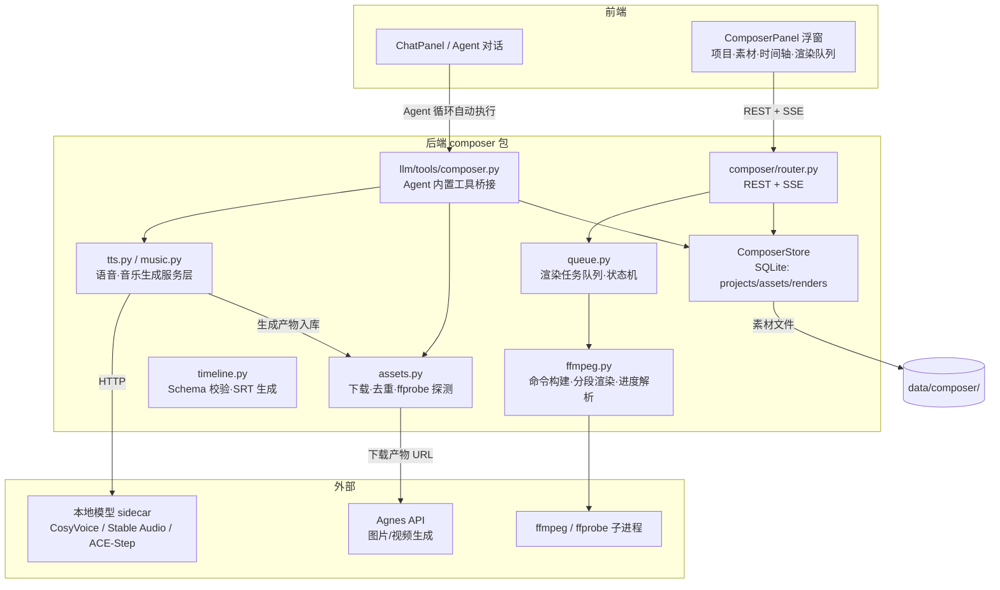

# IRIS VIDEO COMPOSER — 完整开发规划

> 基于 README「下一步计划」展开的实施规划。当前版本 **0.39.0**（M1-M5 全部完成，GA），本特性自 0.34.0 起为主线开发内容。
>
> 本文档是唯一的特性级规划源：目标、架构、数据模型、API、里程碑、验收标准均以此为准，实施时按里程碑逐段迁移至 `CHANGELOG.md` 待发布区。

---

## 1. 目标与范围

### 1.1 目标

将 IrisFlow 生成的各类媒体素材整合为完整视频，形成 **脚本 → 素材生成 → 时间轴编排 → 合成渲染 → 预览下载** 的端到端闭环：

1. **素材接入** — 汇聚 `agnes_video_create` 视频片段、`agnes_image_generate` 图片、**语音生成（TTS，§8.4）**、**背景音乐生成（§8.4）**、上传素材与字幕文本，统一入库管理。
2. **时间轴编排** — LLM 根据脚本规划素材顺序、时长与镜头节奏，生成**可编辑**的时间轴；用户可在控制台手动调整。
3. **合成渲染** — 视频片段拼接 + 转场、图片镜头（Ken Burns 运镜 / 定格）、字幕烧录（SRT/ASS）、音频轨道混合（旁白 + BGM + 音量）。
4. **产物交付** — 导出 MP4，控制台内直接预览与下载。

### 1.2 非目标（明确排除）

- ❌ 多用户 / 协同编辑（单机单用户控制台）
- ❌ GPU 加速编码（CPU libx264 足够，保持零额外环境依赖）
- ❌ 任意精度逐帧编辑（面向"AI 生成内容的二次组装"，不是专业 NLE）
- ❌ 实时预览渲染（预览 = 素材原始回放 + 关键帧缩略图，成品必须真实渲染）

### 1.3 端到端验收场景（定义"完成"）

> 在控制台对 Agent 说：「用 3 个镜头做一个关于 XX 的 15 秒短视频，配旁白、字幕和背景音乐」
> → Agent 调 `agnes_video_create` / `agnes_image_generate` 生成素材、`composer_tts` 合成旁白、`composer_bgm` 生成背景音乐，全部自动入库
> → Agent 调 composer 工具规划时间轴 + 字幕
> → 提交渲染，ComposerPanel 实时显示分段进度
> → 完成后浮窗内预览 MP4、一键下载。
> 全程无后端重启、无手动干预。

---

## 2. 现状基础盘点

### 2.1 可直接复用的架构资产

| 资产 | 位置 | 复用方式 |
|------|------|----------|
| Agnes 图片生成 | `mcp/agnes/server.py` `agnes_image_generate` | 素材来源之一，产物 URL 下载入库 |
| Agnes 视频生成（异步） | `agnes_video_create` / `agnes_video_status` | 素材来源之二；`video_id` 轮询完成后立即下载（URL 会过期） |
| 内置工具注册/执行 | `llm/tools/`（`ToolExecutor` + `BUILTIN_TOOLS`；`web_search`/`open_url` 直连 HTTP 先例） | composer 工具集 + TTS 语音生成作为新的内置工具模块接入，Agent 循环内自动执行 |
| 工具组开关 | `ToolGroupPanel` + `/api/tools` 工具组 | composer 工具归入「合成器」组，用户可整体启停 |
| 状态权威源 + SSE 推送 | `router.py` FIFO 队列 + `status-stream` | 渲染任务队列沿用同一模式（独立队列、独立 SSE 流） |
| SessionStore 持久化模式 | `sessions.py`（SQLite + LRU + TTL + `asyncio.Lock`） | `ComposerStore` 照搬此模式管理项目/素材/渲染任务 |
| 优雅关闭 | `main.py` lifespan + `shutdown_generations()` | 渲染任务同样需要 shutdown 时取消 + 杀 ffmpeg 子进程 |
| 浮窗框架 | `FloatingWindow.vue`（拖拽/置顶/z-index） | ComposerPanel 及其子面板全部基于此框架 |
| 媒体预览 | `MediaPreview.vue`（图片/视频/网页统一预览） | 扩展支持本地素材流播放与成品 MP4 播放 |
| 常量集中管理 | `constants.py` / `constants.ts` | 新增 `COMPOSER_*` 常量段，前后端同步 |
| 配置持久化 | `AppConfig` + `data/*.json` + `${VAR}` 密钥 | 合成器配置（ffmpeg 路径、并发、预设）走同一机制 |

### 2.2 现状缺口（本规划需补齐）

| 缺口 | 现状 | 影响 |
|------|------|------|
| **音视频上传不支持** | `uploads.py` 仅支持图片（base64 多模态）/ 文本 / 文档，无 `.mp4` `.mp3` 等 | 用户无法上传本地视频片段 / BGM；需为 composer 开独立素材上传通道（上限与聊天上传 10MB 解耦） |
| **无 ffmpeg 依赖** | 后端零音视频处理能力 | 需引入 ffmpeg/ffprobe 外部二进制 + 启动探测 + 可配置路径 |
| **无语音 / 音乐生成能力** | Agnes 仅提供图片/视频生成（视频 reference 模式的 `audios` 参数只是参考素材输入，非合成）；后端无任何 TTS / 音乐生成 | 旁白与 BGM 均需外接生成模型 → `composer/tts.py` + `composer/music.py` 服务层 + `composer_tts` / `composer_bgm` 内置工具（§8.4） |
| **无素材持久层** | Agnes 产物只以 URL 形式存在于工具结果文本中，会过期 | 需要素材库：下载、hash 去重、ffprobe 元数据探测 |
| **无文档型时间轴数据结构** | — | 需定义时间轴 JSON Schema + 校验器 |
| **Agent 迭代上限 10 轮** | `agent.py` 硬编码 | 多镜头生成 + 轮询 + 编排可能超限；composer 工具需高合并度设计，必要时将上限常量化/可配置 |
| **前端无时间轴 UI** | — | 需新建（MVP 用分镜列表，后期升级轨道式） |

---

## 3. 总体架构



**核心原则（与现有架构一致）：**

- 后端是**唯一权威源**：项目 / 时间轴 / 素材 / 渲染任务状态全部持久化在后端，前端订阅推送。
- 渲染队列与 LLM 生成队列**相互独立**（互不占用并发额度），但复用同一套队列设计模式（FIFO + `asyncio.shield()` 保护清理 + 优雅关闭）。
- composer 是独立域，放 `backend/composer/` 包；LLM 侧仅通过 `llm/tools/composer.py` 薄桥接（工具调用 → composer 服务层），不把渲染逻辑塞进 `llm/`。

---

## 4. 数据模型设计

### 4.1 素材 Asset

```jsonc
{
  "asset_id": "as_3f8a...",          // 前缀 + 随机 ID（沿用 session_id 风格）
  "kind": "video | image | audio",   // 素材类型
  "source": "agnes | upload | tts | music | url",
  "url": "https://...",              // 原始 URL（溯源用，可能已失效）
  "file_path": "assets/ab/cd/hash.mp4",  // 相对 data/composer 的本地路径（hash 命名去重）
  "sha256": "abcd...",               // 内容 hash，重复导入直接复用
  "size_bytes": 8388608,
  "probe": {                          // ffprobe 探测结果（图片为宽高，音频为时长）
    "duration": 5.0, "width": 1280, "height": 720,
    "fps": 30, "vcodec": "h264", "acodec": "aac", "has_audio": true
  },
  "meta": { "prompt": "...", "agnes_video_id": "..." },  // 生成参数溯源
  "created_at": "2026-11-18T12:00:00Z"
}
```

### 4.2 项目 Project（含时间轴）

```jsonc
{
  "project_id": "pr_...",
  "title": "XX 主题短视频",
  "script": "...",                    // 原始脚本文本（LLM 编排的输入，可空）
  "timeline": {                       // ★ 可编辑时间轴（见 4.3）
    "version": 1,
    "preset": "720p16x9",             // 分辨率/帧率预设（constants 定义全集）
    "tracks": { ... }
  },
  "asset_ids": ["as_..."],           // 项目引用的素材（项目删除时级联判断引用计数）
  "created_at": "...", "updated_at": "..."
}
```

### 4.3 时间轴 Timeline Schema

```jsonc
{
  "version": 1,
  "preset": "720p16x9",               // → 1280x720 @ 30fps（预设表见 §8 常量）
  "tracks": {
    "video": [                        // 视频轨：有序镜头列表（start 由前序段推出，渲染时校验无重叠）
      {
        "asset_id": "as_...",
        "duration": 5.0,              // 时间轴占用时长（秒）
        "trim_in": 0.0,               // 素材入点（视频素材用；图片忽略）
        "transition_in": { "type": "fade", "duration": 0.5 },   // 与前一段的转场（首段忽略）
        "motion": {                    // 图片镜头运镜（视频素材忽略）
          "type": "kenburns" | "static",
          "from_zoom": 1.0, "to_zoom": 1.15, "pan": "none | left | right | up | down"
        }
      }
    ],
    "audio": [                        // 音频轨：多角色并行
      {
        "role": "narration" | "bgm",
        "asset_id": "as_...",
        "start": 0.0, "duration": 10.0,   // 超出素材时长时循环（BGM）或截断（旁白）
        "gain": 1.0, "fade_in": 0.0, "fade_out": 2.0, "loop": true
      }
    ],
    "subtitles": [                    // 字幕轨（烧录，非软字幕）
      { "start": 0.2, "end": 3.5, "text": "第一句旁白", "style": "default" }
    ]
  }
}
```

**校验规则（`timeline.py` 负责入库前校验）：**
- 所有 `asset_id` 必须存在于素材库且 `kind` 匹配轨道类型
- 视频 `duration` ≤ 素材探测时长（视频类）；图片 duration ∈ [0.5, 30]
- 字幕区间不强制有序/不重叠（重叠时渲染报 warning 并按序烧录），但 start < end 必须成立
- 转场 duration < 相邻两段各自时长
- Schema 校验失败返回逐字段错误信息（LLM 工具调用时能看到，可自纠错）

### 4.4 渲染任务 Render

```jsonc
{
  "render_id": "rd_...",
  "project_id": "pr_...",
  "state": "queued | preparing | rendering | muxing | completed | failed | canceled",
  "progress": 0.42,                   // 0~1，按段加权汇总
  "stage_detail": { "total_segments": 5, "done_segments": 2, "current": "segment 3/5" },
  "output_path": "renders/rd_.../output.mp4",
  "error": null,                      // 失败时的 ffmpeg stderr 尾部（截断保留）
  "created_at": "...", "finished_at": "..."
}
```

状态机：`queued → preparing（规格化分段）→ rendering（逐段渲染+拼接）→ muxing（字幕烧录+音轨混合）→ completed`；任意状态可 `canceled`（杀子进程），异常进 `failed`。

---

## 5. 存储布局

```
backend/data/composer/
├── composer.db          # SQLite：projects / assets / renders 三张表
├── assets/              # 素材本体，hash 前两字符分桶：assets/ab/cd/<sha256>.<ext>
├── renders/
│   └── <render_id>/     # 中间分段（seg_000.mp4...）+ 最终 output.mp4
└── subtitles/           # 时间轴字幕生成的 .srt / .ass（随项目走，可重建）
```

- **SQLite 而非 JSON 文件**：项目/渲染状态高频更新，沿用 `SessionStore` 模式（`asyncio.Lock` 单写者 + LRU 缓存 + 忙等待超时），独立 `composer.db` 与 `sessions.db` 隔离。
- **hash 分桶 + 引用计数**：同一素材被多项目引用只存一份；项目删除时引用计数归零的素材文件一并清理。
- **渲染中间文件即用即删**：`muxing` 完成后删除分段，只留 `output.mp4`。
- **磁盘水位**：素材入库 + 渲染完成时检查 `data/composer` 总量，超过配置上限（默认 5 GB）时 SSE 推送告警事件，不自动删除（M3 先告警，M5 可做 LRU 回收策略）。

---

## 6. API 设计

新增路由前缀 `/api/composer`，独立 `composer/router.py`，`main.py` 挂载。

| 端点 | 方法 | 说明 |
|------|------|------|
| `/api/composer/projects` | GET / POST | 项目列表（含最近渲染状态）/ 创建（可携带 `script`） |
| `/api/composer/projects/{id}` | GET / PATCH / DELETE | 项目详情（含完整时间轴）/ 更新标题·脚本·时间轴（走 Schema 校验）/ 删除（级联清理） |
| `/api/composer/assets` | GET / POST | 素材列表（`kind` / `project_id` 过滤）/ 从 URL 拉取入库（下载 + hash 去重 + ffprobe） |
| `/api/composer/assets/upload` | POST | 本地文件上传入库（独立于聊天 `/api/upload`，上限 500 MB，仅音视频/图片类型） |
| `/api/composer/assets/tts` | POST | TTS 语音合成入库（文本 + 音色 → 音频素材；前端快捷生成与 Agent 工具共用服务层） |
| `/api/composer/assets/music` | POST | BGM 音乐生成入库（风格/时长描述 → 音频素材；时间轴 BGM 轨 loop 补足总时长） |
| `/api/composer/assets/{id}` | GET / DELETE | 素材详情（含 probe 元数据）/ 删除（引用计数归零才删文件） |
| `/api/composer/assets/{id}/file` | GET | 素材流式播放（支持 Range，供预览与时间轴缩略图） |
| `/api/composer/projects/{id}/render` | POST | 校验时间轴 → 提交渲染任务（入队） |
| `/api/composer/renders` | GET | 渲染任务列表（`project_id` 过滤） |
| `/api/composer/renders/{id}` | GET | 任务详情（状态 + 进度 + 错误） |
| `/api/composer/renders/{id}/cancel` | POST | 取消（杀 ffmpeg 子进程，状态 → canceled） |
| `/api/composer/renders/{id}/file` | GET | 成品 MP4 流式播放（Range）/ `?download=1` 附件下载 |
| `/api/composer/status-stream` | GET | SSE：项目变更 / 素材入库 / 渲染进度与状态（心跳 15s，同现有模式） |
| `/api/composer/config` | GET / PUT | 合成器设置：ffmpeg 路径、渲染并发（默认 1）、磁盘上限、预设表 |

**SSE 事件类型**（`constants.py` 新增 `COMPOSER_SSE_*`）：

```
composer_project    # 项目创建/更新/删除
composer_asset      # 素材入库/删除
composer_render     # 渲染状态迁移（state 变化时）
composer_progress   # 渲染进度（节流 ~1s/次，避免高频刷屏）
composer_warn       # 磁盘水位等告警
```

---

## 7. ffmpeg 渲染管线设计

### 7.1 引擎选型：subprocess 直调 ffmpeg（不引入 moviepy）

| 方案 | 结论 |
|------|------|
| **subprocess + ffmpeg CLI** ✅ | 零 Python 依赖、内存可控、`-progress pipe:1` 原生进度、filter_complex 覆盖全部需求（concat/xfade/zoompan/subtitles/amix）、与项目"薄封装 + 显式控制"风格一致（client.py 就是手写 SSE 解析而非用 SDK） |
| moviepy | 长视频内存峰值高、渲染慢、2.x API 大改、底层最终还是拼 ffmpeg 命令 —— 只增加了一层不可控抽象，排除 |
| ffmpeg-python（命令构建库） | 只是字符串拼接 DSL，debug 时反而隔了一层；直接手写参数列表 + 常量集中管理更透明，不引入 |

### 7.2 渲染策略：分段渲染 + concat（不做超长 filter_complex）

```
preparing   → 逐镜头独立转码为统一规格的分段（seg_NNN.mp4）
rendering   → concat demuxer 拼接分段（+ 相邻段 xfade 转场）
muxing      → 字幕烧录 + 音频混合 + faststart 封装
```

理由：
- 超长 `filter_complex`（几十个输入）在 Windows 上易触发隐晦崩溃，且单点失败全部重来；分段后**失败可按段重试**，进度按段加权精确可报。
- 统一规格化解决 Agnes 素材分辨率/帧率/编码不一致问题：`scale + pad` 到目标分辨率、`fps` 统一、`yuv420p`、音频统一 `aac 44.1k`。
- 图片镜头在此阶段落地：`loop` + `zoompan`（Ken Burns）或定格。
- 转场在拼接阶段两两处理（xfade 需要重叠时长，从后段 transition_in.duration 扣除）。

### 7.3 关键命令要点

- **进度**：`-progress pipe:1 -nostats`，解析 `out_time_ms` / `frame`，按段时长加权汇总为全局 progress。
- **字幕**：MVP 用 `subtitles=xxx.srt`（SRT 由 `timeline.py` 从字幕轨生成，时间轴秒 → `HH:MM:SS,mmm`）；M4 升级 ASS 支持样式（字体/描边/位置）。
- **音频**：`amix` 混合旁白 + BGM，各轨 `volume` 落实 gain/fade；M4 增加旁白优先压 BGM（`sidechaincompress`）。
- **取消**：子进程存于任务对象，cancel 时 `terminate()` → 宽限期 → `kill()`；Windows 下走 `CREATE_PROCESS_GROUP` 保证可终止整棵进程树。
- **失败诊断**：stderr 尾部 500 字符存入 `render.error`（沿用 `ERROR_DETAIL_TRUNCATE` 风格），完整日志写 `logs/composer-<render_id>.log`。
- **编码参数**：`libx264 preset=veryfast crf=23`（常量入 `constants.py`，M4 暴露到配置）。

### 7.4 ffmpeg 环境探测

- 启动时（lifespan）按序探测：配置的路径 → `PATH` 中的 `ffmpeg`/`ffprobe`（Windows 加 `.exe`）→ 记录 `ffmpeg_available`。
- 探测失败**不阻塞启动**（与 MCP 初始化一致）：composer API 返回带 `ffmpeg_missing` 的明确错误，设置面板展示安装指引，`/api/composer/config` 可配自定义路径。
- README「快速开始」增加 ffmpeg 安装说明（Windows: winget / 官网；Linux: apt）。

---

## 8. LLM 编排设计（Agent 内置工具集）

### 8.1 工具集（`llm/tools/composer.py`，注册进 `BUILTIN_TOOLS`，归属「合成器」工具组）

| 工具 | 参数 | 行为 |
|------|------|------|
| `composer_create_project` | `title, script?` | 创建项目，返回 project_id |
| `composer_import_asset` | `url, kind?` | 下载 URL → hash 去重 → ffprobe 探测入库；返回 asset_id + 元数据摘要 |
| `composer_import_generated` | `video_id` | **Agnes 专用**：按 `agnes_video_status` 轮询到 completed 后下载入库（封装轮询，避免 Agent 反复调 status 耗尽迭代轮次） |
| `composer_tts` | `project_id, text, voice?, speed?` | 调 TTS 模型合成旁白（§8.4）→ 自动入库（source=tts）→ 返回 asset_id + 探测时长；一次调用完成「合成 + 入库」 |
| `composer_bgm` | `project_id, style, duration?, mood?` | 调音乐模型生成 BGM 片段（§8.4）→ 入库（source=music）→ 返回 asset_id + 时长；时间轴 BGM 轨 `loop: true` 自动补足总时长 |
| `composer_set_timeline` | `project_id, timeline(JSON 字符串)` | 校验并整体写入时间轴；校验失败返回逐字段错误（LLM 可自纠） |
| `composer_start_render` | `project_id` | 校验 → 提交渲染队列，返回 render_id |
| `composer_render_status` | `render_id` | 返回状态 + 进度（渲染中调用不阻塞，Agent 可告知用户稍后） |

**工具描述即 Schema 文档**：`composer_set_timeline` 的 docstring 内嵌时间轴 JSON 模板与字段约束，LLM 一次调用写入完整时间轴（高合并度设计，对抗 10 轮迭代上限）。

### 8.2 典型 Agent 工作流

```
用户："做一个 15 秒的 XX 短视频，3 个镜头，配旁白、字幕和 BGM"
 1. composer_create_project(title, script=扩写后的分镜脚本)
 2. agnes_video_create(镜头1) ×3（并行发起，拿到 video_id 列表）   ← Agent 循环
 3. composer_import_generated(video_id) ×3（封装轮询+下载+入库）
 4. composer_tts(旁白文案)（TTS 合成 + 自动入库，返回 asset_id 与时长）
 5. composer_bgm(风格描述)（音乐生成 + 入库；用户指定了 BGM 文件时改为 import/upload）
 6. composer_set_timeline(完整时间轴 + 从脚本切分的字幕 + 旁白/BGM 轨)
 7. composer_start_render → 返回 render_id
 8. 汇报：「已提交渲染，进度可在合成器面板查看」（渲染耗时长，Agent 不等待完成）
```

### 8.3 迭代上限对策

`agent.py` 的 `MAX_TOOL_ITERATIONS = 10` 硬编码需**常量化进 `constants.py` 并可配置**（默认仍 10）。理由：3 镜头场景下「3×create + 3×import + tts + bgm + plan + render ≈ 10 轮」已贴满上限，素材更多时必然超限。此项列入 M1（纯重构，无行为变化）。

### 8.4 语音与音乐生成模型（TTS + BGM）

**定位**：旁白配音与背景音乐的生成来源。Agnes 无语音/音乐合成能力（其视频接口的 `audios` 仅为参考素材输入），独立接入两类生成模型，补齐「一句话全生成出片」的最后一块拼图。

**形态**：后端服务层 `composer/tts.py` + `composer/music.py`，各自暴露内置工具（`composer_tts` / `composer_bgm`）与 REST 端点（`POST /api/composer/assets/tts` / `music`），共用素材入库管线。**不走 MCP**——生成本质是一次 HTTP 调用，对齐 `web_search` / `open_url` 直连 HTTP 的内置工具先例。

**Sidecar 模式（本地模型的关键约束）**：本地模型（CosyVoice / Stable Audio 等）全为 torch 栈、锁定较低版本 Python，与后端的 Python 3.14 不兼容——**模型服务以旁路进程独立运行（各自 venv、自带 HTTP server），backend 仅用 httpx 对接 `http://127.0.0.1:<port>`**。部署脚本与说明集中放仓库 `deploy/` 目录；`GET /api/composer/config` 返回各 provider 的连通探测结果。

**推荐组合**（分层设计，任意一层缺失都能降级出片）：

| 能力 | 首选 | 降级路径 | 说明 |
|------|------|---------|------|
| 语音（旁白） | **CosyVoice 2.5** 本地 sidecar（中文质量顶级、低延迟、隐私、无按量费用） | → **SiliconFlow 云端 API**（`FunAudioLLM/CosyVoice2-0.5B`，同款模型，无 GPU / 不想维护本地服务时）→ **edge-tts**（免费零密钥最终兜底，需联网） | 同一模型双运行时，本地/云音色风格一致 |
| 音乐（BGM） | **Stable Audio Open Small** 本地 sidecar（341M、CPU 可跑、纯音乐片段正合 BGM 需求） | 无云端兜底 → 用户上传 / URL 导入 | 单次生成 ~11s 片段，时间轴 BGM 轨 `loop: true` 自动铺满全片 |
| 完整主题曲（可选，M4） | **ACE-Step** 本地 sidecar（3.5B、Apache 2.0、4 分钟带唱完整歌曲、~20s 出片） | — | 与 BGM 共用 `MusicProvider` 抽象，仅 `base_url` 指向不同服务；需 GPU 8-12 GB |

**Provider 抽象**（`TTSProvider` / `MusicProvider` 同构）：

| Provider | 实现 | 语音 | 音乐 |
|----------|------|------|------|
| `local-http`（首选） | httpx 调本地 sidecar（CosyVoice / Stable Audio / ACE-Step 各自的 HTTP API） | ✅ | ✅ |
| `openai-compat` | httpx `POST {base_url}/audio/speech`（OpenAI-compatible 端点） | ✅ SiliconFlow / OpenAI 等 | 视网关能力 |
| `edge` | `edge-tts` 包（微软云端神经音色，免费零密钥） | ✅ 仅语音最终兜底 | — |

**配置**（纳入 `/api/composer/config`，密钥走密钥库 `${TTS_TOKEN}` 引用，对齐 LLM 配置模式）：

```jsonc
{
  "tts": {
    "provider": "local-http",
    "base_url": "http://127.0.0.1:9701/v1",              // CosyVoice sidecar
    "fallback": {                                          // 主 provider 失败自动降级
      "provider": "openai-compat",
      "base_url": "https://api.siliconflow.cn/v1",
      "token": "${TTS_TOKEN}",
      "model": "FunAudioLLM/CosyVoice2-0.5B"
    },
    "default_voice": "旁白·男",
    "speed": 1.0,
    "voices": { "旁白·男": "alex", "旁白·女": "anna" }      // 命名音色映射，LLM 与编辑器按名引用
  },
  "music": {
    "provider": "local-http",
    "base_url": "http://127.0.0.1:9702/v1",              // Stable Audio Open sidecar
    "duration": 11,
    "output_format": "mp3"
  }
}
```

**合成流程（语音）**：`composer_tts(text, voice)` → provider 合成（失败沿降级链 local-http → openai-compat → edge）→ 写入 `assets/`（hash 命名）→ ffprobe 探测时长 → 入库（`source: "tts"`，meta 记录 model/voice）→ 返回 asset_id + 时长。**旁白时长回传给 LLM**，用于对齐镜头时长与字幕节奏。

**生成流程（音乐）**：`composer_bgm(style, duration)` → Stable Audio 生成纯音乐片段 → 入库（`source: "music"`）→ 返回 asset_id + 时长；时间轴中 BGM 轨以 `loop: true` 循环铺满全片、`fade_out` 收尾。所有 provider 均不可用时返回引导信息（建议上传 BGM 或配置 sidecar），**不阻塞编排**。

**进阶（M4）**：语音长文本分句合成 + ffmpeg concat 拼接；音乐切换 ACE-Step 生成完整主题曲（含人声）。

---

## 9. 前端设计

### 9.1 新增组件（全部基于 FloatingWindow 框架）

```
components/floating/ComposerPanel.vue      # 主浮窗：标签页（项目 / 素材 / 时间轴 / 渲染）
components/composer/ProjectList.vue        # 项目列表 + 新建（粘贴脚本）
components/composer/AssetLibrary.vue       # 素材库：缩略图网格 + 类型过滤 + 上传 + URL 导入 + TTS/BGM 快速生成（文本/风格 → 入库）
components/composer/StoryboardEditor.vue   # M2 分镜列表编辑器（见下）
components/composer/TimelineTracks.vue     # M5 轨道式时间轴（拖拽/缩放/波形）
components/composer/RenderQueue.vue        # 渲染队列：状态灯 + 进度条 + 取消 + 预览/下载
```

### 9.2 时间轴编辑的演进策略（控制 UI 复杂度）

- **M2 — 分镜列表编辑器（StoryboardEditor）**：以「镜头卡片」纵向列表呈现视频轨——每张卡片含素材缩略图、时长、入点、转场、运镜下拉；字幕为可增删的区间列表；音频为两行（旁白/BGM）轨道条。**JSON 双向绑定 timeline，改动即 PATCH**。此形态已覆盖 90% 的"AI 生成后微调"需求，开发量约为轨道式的 1/3。
- **M5 — 轨道式时间轴（TimelineTracks）**：水平轨道 + 拖拽排布 + 时间标尺 + playhead 预览。仅在分镜列表被验证不够用之后做。

### 9.3 状态管理

- `composables/useComposer.ts`：模块级单例（对齐 `toolMetadata` 模式）——持有项目/素材/渲染列表 + SSE 订阅 `status-stream`，多浮窗共享一份状态。
- `api/client.ts` 新增 `composer` 命名空间：REST 方法 + SSE 订阅复用现有解析器。
- ChatPanel 对话中的 Agnes 结果增加「发送到合成器」动作（提取 URL → 调 `POST /assets`），打通"手动路径"。

### 9.4 常量同步（`constants.ts`）

新增：SSE 事件类型、渲染状态（复用会话状态灯配色语义：🟢 completed / 🟡 rendering / 🔵 queued）、分辨率预设表、素材类型图标映射（对齐 `toolMetadata` 的图标风格）。

---

## 10. 依赖与环境变更

| 项 | 变更 | 说明 |
|----|------|------|
| 外部二进制 | **ffmpeg + ffprobe（必须）** | 启动探测 + 可配置路径 + README 安装指引 |
| 本地模型 sidecar（可选） | CosyVoice 2.5（语音）/ Stable Audio Open Small（BGM）/ ACE-Step（主题曲，M4） | 独立 venv + HTTP 服务，部署脚本放 `deploy/`；未部署时自动降级云端 API / 上传（§8.4） |
| Python 包 | 无必须新增 | subprocess/httpx/pydantic 均已有 |
| Python 包（M2，TTS 兜底 provider） | `edge-tts` | 云端免费兜底（微软神经音色，需联网）；`local-http` / `openai-compat` provider 仅用已有 httpx，零新增（§8.4） |
| 前端包 | 无（M5 轨道编辑器如需拖拽库再评估） | — |
| 配置文件 | `data/composer_config.json` | ffmpeg 路径 / 渲染并发 / 磁盘上限 / 编码参数 / TTS + 音乐配置段（走 `AppConfig` 模式） |

---

## 11. 分阶段实施计划

> 每个里程碑独立可发布、可验收；完成后走 `version-bump` 流程，条目写入 `CHANGELOG.md`。后端改动均需过 `uv run pyright`，前端过 `npx vue-tsc --noEmit`。

### M1 — 素材管线（0.34.0）

**目标**：素材能进能存能看，渲染能力尚未引入。

| 端 | 任务 |
|----|------|
| 后端 | `composer/` 包骨架（`store.py` SQLite 三表 + Lock/LRU）；`assets.py`（URL 下载 + hash 去重 + ffprobe 探测 + MIME 判型）；`/api/composer/assets*` 全套 + 素材上传端点（500MB 上限、仅媒体类型）；SSE `status-stream` 骨架 + `composer_asset` 事件；ffmpeg 启动探测 + `/api/composer/config` |
| 后端 | `MAX_TOOL_ITERATIONS` 常量化 + 可配置（§8.3，为后续铺路） |
| 前端 | `useComposer.ts` + client composer 命名空间；`ComposerPanel.vue` 浮窗 + `AssetLibrary.vue`（网格缩略图/上传/URL 导入/删除）；MediaPreview 支持本地素材流播放 |
| 文档 | README 快速开始补 ffmpeg 安装；CHANGELOG 待发布区开条目 |

**验收**：粘贴一个 Agnes 图片 URL → 入库出现缩略图与探测元数据；上传本地 mp3/mp4 成功；重复导入同 URL 秒级返回（去重命中）；删除素材引用计数正确。

### M2 — 时间轴模型 + LLM 编排 + 语音/音乐生成（0.35.0）

**目标**：Agent 能端到端"编排出一个合法时间轴"（含旁白配音与 BGM），用户能手动微调。

| 端 | 任务 |
|----|------|
| 后端 | `timeline.py`（Schema + 校验器 + SRT 生成）；projects 表 + `/api/composer/projects*` 全套；`composer/tts.py` 语音服务层（local-http / openai-compat / edge 三 provider + fallback 降级链，§8.4）+ `composer/music.py` 音乐服务层（Stable Audio sidecar）+ `/api/composer/assets/tts` / `music` 端点 + 配置进 `/api/composer/config`；`deploy/` 本地模型 sidecar 部署脚本（CosyVoice / Stable Audio Open）；`llm/tools/composer.py` 八工具注册（本里程碑不含 render 相关，`composer_start_render` 先返回「渲染功能即将上线」占位，保持工具集契约稳定）；工具组「合成器」进 `/api/tools` |
| 前端 | `ProjectList.vue`；`StoryboardEditor.vue`（镜头卡片 + 字幕列表 + 旁白/BGM 音频轨，PATCH 即存）；AssetLibrary 的 TTS / BGM 快速生成入口；SSE `composer_project` 实时刷新 |

**验收**：对 Agent 说「把这几个素材排成 15 秒带旁白和字幕的时间轴」→ Agent 调 `composer_tts` 合成旁白（sidecar 未启动时自动降级云端 / edge）、`composer_bgm` 生成 BGM，并产出合法 timeline（校验通过）→ 分镜编辑器中可见可改、旁白 / BGM 可试听；音乐服务不可用时 `composer_bgm` 返回引导信息不阻塞；故意让 LLM 产出非法 timeline（超时长引用）时能收到逐字段错误并自纠重试。

### M3 — 渲染管线 MVP（0.36.0）★ 核心里程碑

**目标**：端到端出片 —— §1.3 验收场景全流程打通。

| 端 | 任务 |
|----|------|
| 后端 | `ffmpeg.py`（命令构建 + 分段渲染 + 进度解析 + 子进程管理/取消）；`queue.py`（渲染队列 + 状态机 + `shield` 清理 + 优雅关闭杀子进程）；`renders` 表 + render/cancel/file 全套 API；SSE `composer_render` / `composer_progress`（节流 1s）；`composer_start_render` / `composer_render_status` 工具接真实现 |
| 前端 | `RenderQueue.vue`（进度条 + 状态灯 + 取消）；成品 MP4 浮窗内播放 + 下载；ComposerPanel 四标签页成形 |
| 范围 | 拼接（无转场）+ SRT 字幕烧录 + 双音轨 amix 混合 + 统一规格化 |

**验收**：§1.3 场景通过；渲染中取消立即生效（子进程退出、状态 canceled、中间文件清理）；人为构造 ffmpeg 失败（改坏素材文件）→ 任务 failed 且 error 含 stderr 尾部；后端重启后渲染历史完整、磁盘水位告警可见。

### M4 — 高级合成（0.37.0）

**目标**：从"能出片"到"出好片"。

- xfade 转场（fade/dissolve/slide，拼接阶段两两处理）
- Ken Burns 运镜（zoompan：from/to zoom + 方向 pan）
- ASS 样式化字幕（字体/字号/描边/底栏位置，编辑器暴露样式预设）
- 音频进阶：BGM 循环、fade in/out、旁白优先压 BGM（sidechaincompress）
- TTS 进阶：长文本分句合成 + ffmpeg concat 拼接（§8.4）、语速/情感参数暴露到编辑器、多说话人对话合成、命名音色库管理
- 音乐进阶（可选高配）：ACE-Step 完整主题曲生成（4 分钟带唱、GPU 8-12 GB，与 BGM 共用 `MusicProvider`，§8.4）
- 编码参数可配置（preset/crf 暴露到 composer config）

**验收**：同一项目渲染出含转场 + 运镜 + 样式字幕 + 混音的成片；长文案旁白自动分句合成为单素材；配置 ACE-Step 后可生成完整主题曲入轨。

### M5 — 体验完善（0.38.0）

- `TimelineTracks.vue` 轨道式时间轴（拖拽排布 / 时间标尺 / playhead 素材预览）
- 项目模板（预设时间轴骨架：产品介绍/口播/图文混排）
- 磁盘水位 LRU 回收策略（可配置自动清理）
- ChatPanel「发送到合成器」入口；渲染完成 toast 通知
- README/CHANGELOG 全量更新，特性标记为 GA

---

## 12. 风险与对策

| 风险 | 概率 | 影响 | 对策 |
|------|------|------|------|
| 用户环境无 ffmpeg | 高（Windows 开发机） | 渲染不可用 | 启动探测不阻塞启动 + config 可配路径 + 设置面板安装指引 + README 文档；兜底可选集成 `imageio-ffmpeg` 自带二进制 |
| 超长 filter_complex 崩溃 | 中 | 长视频渲染失败 | 已定分段渲染 + concat 策略（§7.2），失败按段重试 |
| 渲染耗时长（≥ 素材时长数倍） | 高 | 等待体验差 | 异步队列 + SSE 进度 + 可取消 + 完成通知；Agent 不阻塞等待 |
| Agnes URL 过期 | 高 | 素材丢失 | `composer_import_generated` 轮询完成**立即下载**；素材以本地文件为唯一权威 |
| 语音/音乐服务不可用（sidecar 未启动 / 云端未配置） | 中 | 旁白 / BGM 生成失败 | 语音三级降级链 local-http → openai-compat → edge（§8.4）；音乐无云端兜底时 `composer_bgm` 返回引导信息（上传 / URL 替代），不阻塞编排 |
| 磁盘增长（素材+成品+中间件） | 高 | 爆盘 | hash 去重 + 引用计数级联删除 + 中间文件即用即删 + 水位告警（M5 自动回收） |
| Agent 10 轮迭代不够 | 中 | 编排中断 | 工具高合并度（一次 set_timeline 写全量）；上限常量化可配置（M1 落地） |
| SQLite 并发写 | 低 | 状态错乱 | 沿用单写者 Lock 模式；渲染进度仅驻内存 + SSE 节流，落库仅状态迁移时 |
| Windows 子进程终止不干净 | 中 | 僵尸 ffmpeg 占 CPU | `CREATE_PROCESS_GROUP` + terminate→kill 宽限；shutdown 钩子全量清理 |
| LLM 生成非法 timeline | 高 | 编排失败 | 校验器返回逐字段错误供自纠；工具 docstring 内嵌 schema 模板；前端编辑器双重校验 |
| 大文件上传超时 | 中 | 导入失败 | 素材上传独立端点 + 流式写盘 + 500MB 上限；下载 Agnes 产物走流式 + 重试 |

---

## 13. 里程碑总览

| 里程碑 | 版本 | 主题 | 核心交付 | 相对工作量 |
|--------|------|------|----------|-----------|
| M1 | 0.34.0 | 素材管线 | 素材库 + 上传/导入 + ffprobe + 配置 | ★★ |
| M2 | 0.35.0 | 时间轴 + 编排 + 语音/音乐生成 | Schema + 八工具（语音 + BGM）+ 分镜编辑器 | ★★★ |
| M3 | 0.36.0 | 渲染 MVP | ffmpeg 管线 + 队列 + 进度 + 出片 | ★★★★ |
| M4 | 0.37.0 | 高级合成 | 转场/运镜/ASS/混音/TTS 进阶/主题曲 | ★★★ |
| M5 | 0.38.0 | 体验完善 | 轨道编辑器 + 模板 + 回收策略 | ★★★ |

**贯穿性约束**（每个里程碑都适用）：
- 所有硬编码字符串进 `constants.py` / `constants.ts`；`uv run pyright` + `npx vue-tsc --noEmit` 零错误
- 每个里程碑完成后执行 `version-bump` 流程同步版本与文档
- 后端新增 API 全部登记进 README「API 一览」表
