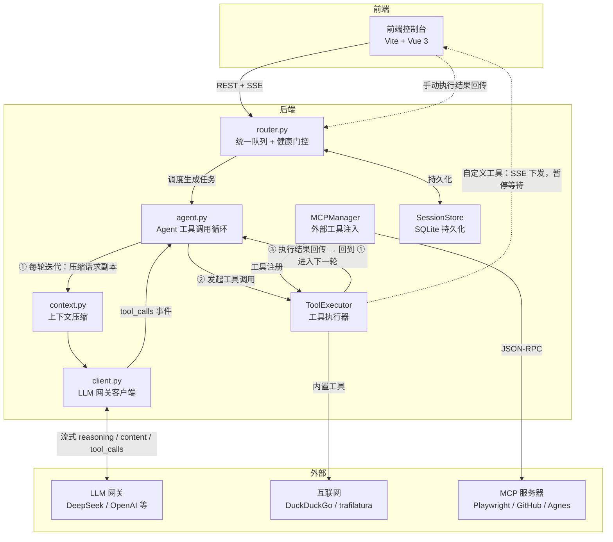

# IrisFlow

[]()
[]()
[]()
[]()

**IrisFlow** 是一个 LLM Chat + Agent 控制台。后端基于 FastAPI 提供 OpenAI-compatible 网关，前端基于 Vite + Vue 3 提供聊天面板。支持流式对话（SSE）、Agent 工具调用推理循环、MCP 外部工具集成（浏览器自动化 / GitHub / 图像视频生成）、会话持久化与多格式文件上传。

## ✨ 功能特性

### 对话与推理

| 功能 | 说明 |
|------|------|
| 💬 流式聊天 | SSE 实时推送 `reasoning` / `content` / `tool_call` / `tool_result` 事件，心跳保活，页面刷新后可从事件历史续传 |
| 🧠 思考模式 | 每轮对话独立开关，思考过程流式展示；兼容 DeepSeek 等模型的 `reasoning_content` 多轮回传校验 |
| 🤖 Agent 工具循环 | 多轮工具调用推理：内置工具自动执行并循环回传直至模型给出最终回复；自定义工具暂停等待手动执行后继续（最多 10 轮迭代） |
| 📐 上下文压缩 | 对话超出预算时自动压缩：长工具结果截断保留首尾 → 按轮丢弃最老对话（保持工具调用配对）→ 注入压缩提示；仅作用于请求副本，历史完整保留 |
| 🗑️ 生成中止 | 随时终止正在生成/排队中的回复，会话状态自动恢复 |

### 工具生态

| 工具 | 来源 | 能力 |
|------|------|------|
| `web_search` | 内置 | DuckDuckGo 网页搜索（Instant Answer + HTML 回退） |
| `open_url` | 内置 | trafilatura 智能网页内容提取 |
| `calculator` | 内置 | 安全表达式计算（白名单函数） |
| `browser_*`（25 个） | MCP · Playwright | 浏览器自动化：导航、点击、输入、截图、页面快照、JS 执行、网络监控 |
| `github`（40+ 个） | MCP · GitHub Copilot | 仓库管理、代码搜索、Issue/PR 操作、评审评论 |
| `agnes_*`（3 个） | MCP · Agnes AI | **图像生成**、**视频生成**（文生视频 + 状态查询） |

工具通过标准 MCP 协议（JSON-RPC 2.0 over stdio/HTTP）动态注入，运行时增删服务器自动重连，配置文件变更热重载。

### 会话与数据

| 功能 | 说明 |
|------|------|
| 💾 会话持久化 | SQLite 存储，LRU（100 上限）+ TTL（1 小时闲置），重启后完整恢复 |
| 🚦 会话状态 | 四色状态灯（🟢 completed / 🟡 generating / 🔵 pending），SSE 实时推送，多标签页同步 |
| 📎 文件上传 | 90+ 文件类型（最大 10 MB）：图片转 base64 多模态、文本直读、文档经 MarkItDown 转 Markdown |
| 📺 媒体预览 | 图片 / 视频 / 网页 / 文件的统一预览浮窗 |
| 📝 Markdown 渲染 | markdown-it + KaTeX 数学公式 + highlight.js 代码高亮 |

### 控制台界面

| 功能 | 说明 |
|------|------|
| 🪟 浮窗框架 | 通用 FloatingWindow：拖拽、置顶、视口约束、z-index 分层管理 |
| 📋 会话列表 | 按日期分组、置顶、重命名、删除、状态灯 |
| 🔍 工作流日志 | Agent 推理步骤时间线（思考 → 工具调用 → 结果），工具结果 JSON 高亮 |
| ⚙️ 设置面板 | 标签页式：服务器 / LLM / MCP / 密钥 / 默认参数 / 关于，全量配置持久化到 JSON 文件（无 `.env`，`${VAR}` 密钥引用） |
| 🎚️ 会话参数 | 预设胶囊 + 基础/高级标签页：temperature、max_tokens、top_p、top_k、惩罚系数、系统提示词 |

## 🛠️ 技术栈

| 层 | 技术 | 说明 |
|----|------|------|
| **前端** | Vite + Vue 3 + TypeScript | Agent 控制台，无 SSR |
| **后端框架** | FastAPI (Python 3.14) | RESTful API + SSE |
| **包管理** | uv (Python) / pnpm (Node.js) | 依赖与项目管理 |
| **LLM 网关** | OpenAI-compatible API | Chat + Agent 推理（流式 / 思考 / 工具调用） |
| **工具引擎** | 内置工具 + MCP | DuckDuckGo / trafilatura / Playwright / GitHub / Agnes AI |
| **会话持久化** | SQLite | 会话上下文重启后自动恢复 |
| **Markdown** | markdown-it + KaTeX + highlight.js | 公式渲染 + 代码高亮 |

## 🚀 快速开始

### 环境要求

| 工具 | 版本 | 用途 |
|------|------|------|
| [Python](https://www.python.org/downloads/) | **3.14** | 后端运行时 |
| [uv](https://docs.astral.sh/uv/) | 最新版 | Python 包管理 |
| [Node.js](https://nodejs.org/) | **24** | 前端运行时 |
| [pnpm](https://pnpm.io/installation) | 最新版 | Node 包管理 |
| [Git](https://git-scm.com/) | 最新版 | 版本控制 |

### 1. 克隆仓库

```bash
git clone https://github.com/Laity999/IrisFlow-video.git
cd IrisFlow-video
```

### 2. 启动后端

```bash
cd backend
uv sync                                        # 安装依赖
uv run fastapi dev main.py                     # 启动开发服务器
```

> Windows 用户如遇到编码错误，请在命令前加上 `PYTHONUTF8=1`：
> ```bash
> PYTHONUTF8=1 uv run fastapi dev main.py
> ```

后端 API 运行在 `http://localhost:8000`，可通过 `http://localhost:8000/docs` 查看自动生成的 Swagger 文档。

### 3. 启动前端

另开一个终端：

```bash
cd frontend
pnpm install                                   # 安装依赖
pnpm dev                                       # 启动开发服务器
```

打开浏览器访问 `http://localhost:3000` 即可看到控制台页面。

### 4. 初始配置

首次使用需在控制台 **设置面板** 中配置：

1. **LLM**：网关地址（如 `https://api.deepseek.com`）、模型 ID（如 `deepseek-flash`）、鉴权 Token（支持 `${VAR}` 引用密钥）
2. **密钥**：将 Token 等敏感值存入密钥库，配置中以 `${VAR_NAME}` 引用
3. **MCP**（可选）：配置 `mcp.json` 接入 Playwright / GitHub / Agnes AI 等工具服务器

### 验证安装

```bash
# 测试后端根接口
curl http://localhost:8000/
# → {"name":"IrisFlow","version":"0.33.1",...}

# 测试健康检查
curl http://localhost:8000/api/health
# → {"status":"healthy","base_url":"...","default_model":"..."}
```

## 📡 API 一览

| 端点 | 方法 | 说明 |
|------|------|------|
| `/` `/version` `/status` `/api/ping` | GET | 系统信息 / 版本 / 运行状态 / 心跳 |
| `/api/health` | GET | LLM 网关连通性探测 |
| `/api/conversations` | GET / POST | 会话列表 / 新建会话 |
| `/api/conversations/{id}` | GET / PATCH / DELETE | 会话详情 / 改名置顶 / 删除 |
| `/api/conversations/{id}/messages/stream` | POST | 发送消息（SSE 流式，支持 thinking + 工具） |
| `/api/conversations/{id}/stream` | GET | 重连进行中的生成流（页面刷新续传） |
| `/api/conversations/{id}/abort` | POST | 中止生成 |
| `/api/sessions/status-stream` | GET | 会话状态实时订阅（SSE） |
| `/api/agent/chat/continue` | POST | 回传自定义工具执行结果，继续推理 |
| `/api/upload` `/api/upload/config` | POST / GET | 文件上传 / 支持类型与限制 |
| `/api/tools` | GET | 工具元数据（图标 / 标签 / 排序 / 描述）+ 工具组 |
| `/api/mcp/config` `/api/mcp/status` | GET / PUT · GET | MCP 配置读写 / 服务器连接状态 |
| `/api/llm/config` `/api/llm/concurrency` | GET / PUT · GET | LLM 配置 / 并发上限 |
| `/api/session-settings/default` | GET / PUT | 会话默认采样参数 |
| `/api/secrets` | GET / PUT | 密钥库（值不回传，仅 key 列表） |

## 📂 项目结构

```
IrisFlow/
├── backend/
│   ├── main.py                  # 入口，挂载路由 + lifespan（MCP 自动连接 + 残留状态清理）
│   ├── core/                    # config.py（配置单例 + JSON 持久化） / info.py（系统信息端点）
│   ├── llm/                     # IRIS LLM — Chat + Agent + Tools + MCP
│   │   ├── client.py             #   LLM 网关客户端（OpenAI-compatible，流式 + 工具调用累积 + 健康探测）
│   │   ├── context.py            #   上下文压缩（工具结果截断 + 轮次丢弃，仅作用于请求副本）
│   │   ├── chat.py               #   Chat 类 — 消息历史容器
│   │   ├── agent.py              #   Agent(Chat) — 工具调用推理循环（自定义工具暂停/继续）
│   │   ├── tools/                  #   工具包（注册表 + 执行器 + 每工具独立模块）
│   │   │   ├── __init__.py         #     ToolExecutor 单例 + BUILTIN_TOOLS 注册
│   │   │   ├── base.py             #     Tool 抽象基类
│   │   │   ├── web_search.py       #     网页搜索工具
│   │   │   ├── calculator.py       #     计算辅助工具
│   │   │   └── open_url.py         #     打开网页工具
│   │   ├── mcp.py                #   MCP 管理器 — JSON-RPC 2.0 over stdio/HTTP，动态注入 + 热重载
│   │   ├── sessions.py           #   SessionStore — LRU + TTL + SQLite 持久化
│   │   ├── uploads.py            #   文件上传（图片多模态 / MarkItDown 文档转换）
│   │   ├── constants.py          #   全模块共享常量（会话状态、消息角色、SSE 事件类型）
│   │   ├── models.py             #   Pydantic 模型（Chat/Agent/Tool/会话）
│   │   └── router.py             #   REST 路由 + 统一队列调度 + LLM 健康门控
│   ├── data/                     # 配置 JSON + SQLite 数据库（sessions.db）
│   ├── pyproject.toml
│   └── pyrightconfig.json
├── frontend/                    # 前端（Vite + Vue 3）
│   ├── src/
│   │   ├── App.vue               #   根组件 — 会话列表 + 聊天面板 + 动态浮窗 + 心跳
│   │   ├── api/client.ts         #   fetch 封装 + SSE 流式 + 可配置后端地址
│   │   ├── constants.ts          #   全模块共享常量
│   │   ├── composables/          #   useAgent + drafts + toolMetadata + windowZIndex
│   │   ├── utils/                #   纯函数 + Markdown 渲染 + 媒体类型判定
│   │   └── components/           #   Vue SFC 组件
│   │       ├── floating/          #     浮窗子窗体（全部基于 FloatingWindow 框架）
│   │       │   ├── FloatingWindow.vue    #     通用浮窗框架 — 可拖拽 + 置顶 + 视口约束
│   │       │   ├── ConversationList.vue  #     会话列表 — 分组 + 置顶 + 重命名 + 删除 + 状态灯 + SSE 订阅
│   │       │   ├── SettingsPanel.vue     #     设置面板 — 服务器/LLM/MCP/密钥/默认参数/关于 + 全量配置持久化
│   │       │   ├── ToolGroupPanel.vue    #     工具管理浮窗 — MCP 服务器工具组开关
│   │       │   ├── WorkflowDetail.vue    #     工作流详情 — 工具调用 / 结果 / 思考过程查看
│   │       │   └── MediaPreview.vue      #     统一媒体预览 — 图片/视频/网页 + 文件 Markdown 渲染
│   │       ├── ChatPanel.vue      #     聊天面板 — 消息滚动 + 会话加载
│   │       ├── ChatInput.vue      #     输入框 — 工具切换 + 思考开关 + 文件上传
│   │       ├── MessageBubble.vue  #     消息气泡 — Markdown 渲染 + 思考过程
│   │       ├── SessionSettingsPanel.vue  #  会话参数面板 — 预设胶囊 + 基础/高级标签页
│   │       ├── WorkflowLog.vue    #     工作流日志 — Agent 推理步骤时间线
│   │       └── ImageViewer.vue    #     图片缩略图组件
│   └── vite.config.ts            #   Vite 配置 + /api 反向代理
└── README.md
```

## 🏗️ 架构

IrisFlow 采用前后端分离设计。后端是状态的唯一权威源：统一 FIFO 队列调度 + LLM 健康门控 + 并发控制；客户端通过 SSE 订阅实时状态。



图中 ① → ② → ③ 构成 Agent 的**工具调用循环**：每轮迭代先压缩请求副本，再流式调用 LLM；模型发起工具调用时执行并将结果回传，进入下一轮，直至模型给出最终回复。自定义 / MCP 工具（虚线）暂停等待前端手动执行，经 `/api/agent/chat/continue` 续跑推理。

### 后端核心模块

- **Chat**（`llm/chat.py`）— 消息历史容器，会话采样参数（temperature / max_tokens / top_p / top_k / 惩罚系数）随消息更新。
- **Agent**（`llm/agent.py`）— 继承 Chat，工具调用推理循环。内置工具在 `router._generate` 的流式循环中自动执行并回传；自定义工具暂停等待前端手动执行，经 `continue_with_results()` 续跑（最多 10 轮）。
- **Tools**（`llm/tools/`）— `ToolExecutor` 单例管理注册与执行（超时守护、错误隔离）。内置 `web_search` / `open_url` / `calculator`，MCP 工具经 `register()` 动态注入。
- **MCP**（`llm/mcp.py`）— `MCPManager` 单例，标准 MCP 协议（JSON-RPC 2.0 over stdio/HTTP）。启动 diff 重连、运行时增删、文件监听热重载、进程健康检查。
- **Client**（`llm/client.py`）— OpenAI-compatible API 封装。`chat_stream_events()` 产出带类型 SSE 事件（`reasoning` / `content` / `tool_calls`），流式工具调用增量累积；思考模式兼容 `reasoning_content` 多轮回传；400/5xx 错误记录响应体详情。
- **Context**（`llm/context.py`）— 上下文压缩：超长工具结果截断 + 按轮丢弃最老对话 + 压缩提示注入，token 启发式估算。
- **Sessions**（`llm/sessions.py`）— `SessionStore`：SQLite 持久化 + LRU（100）+ TTL（1h），`asyncio.Lock` 守护。
- **Router**（`llm/router.py`）— 统一 FIFO 队列 + LLM 健康门控 + 并发控制，`asyncio.shield()` 保护清理。

### 前端

- **API**（`api/client.ts`）— fetch 封装 + SSE 流式解析 + 可配置后端地址。
- **useAgent** — 统一 chat/agent 状态管理，每会话独立状态 Map；页面刷新后从后端事件历史续传。
- **toolMetadata** — 工具元数据模块级单例，`discoverTools()` 从后端拉取，无硬编码。
- **FloatingWindow** — 通用浮窗框架：Teleport、拖拽、置顶、z-index 分层管理。
- **Markdown** — markdown-it + KaTeX + highlight.js。

## 🔄 工作流

1. 用户在控制台输入消息，可选择启用工具组与思考模式。
2. 消息经 SSE 流式发送到后端，LLM 实时返回 reasoning 和 content。
3. 模型发起工具调用时：内置工具自动执行并将结果回传 LLM 继续推理；自定义工具暂停等待用户手动执行。
4. 前端实时展示工作流日志（思考 → 工具调用 → 结果 → 最终回复）。
5. 对话超出上下文预算时自动压缩（工具结果截断 + 旧轮丢弃），历史完整保留。
6. 会话自动保存到 SQLite，重启后完整恢复。

## 🗺️ 下一步计划

### 🎬 视频合成器（IRIS VIDEO COMPOSER）

将 IrisFlow 生成的各类媒体素材整合为完整视频：

- **素材接入**：汇聚 `agnes_video_create` 生成的视频片段、`agnes_image_generate` 生成的图片、音频（语音合成 / 背景音乐）与字幕文本
- **时间轴编排**：由 LLM 根据脚本规划素材顺序、时长与镜头节奏，生成可编辑的时间轴
- **合成渲染**：
  - 视频片段拼接 + 转场效果
  - 图片镜头（Ken Burns 运镜 / 定格时长）插入
  - 字幕烧录（SRT 生成 + 样式化渲染）
  - 音频轨道混合（旁白 + 背景音乐 + 音量调节）
- **产物交付**：导出 MP4，在控制台内直接预览与下载

预计技术方案：ffmpeg / moviepy 渲染管线 + 后端合成任务队列 + 前端时间轴预览界面。

## 📄 许可证

本项目基于 Apache-2.0 开源。
